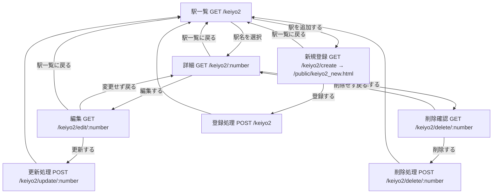
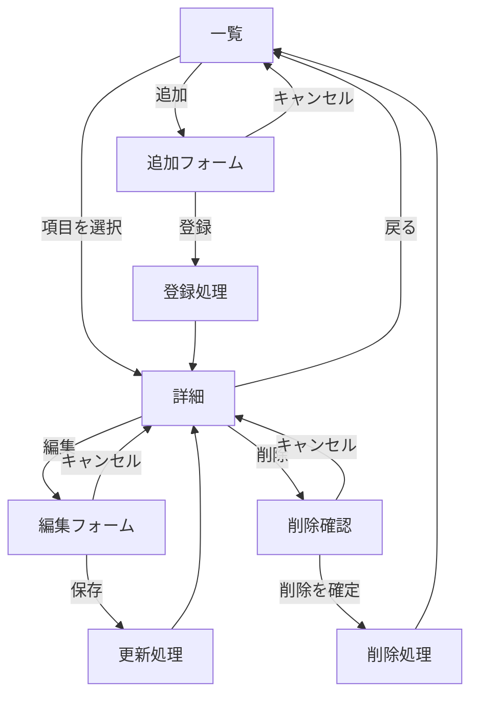

# 第10回 京葉線データベースアプリのCRUD

ソースコードのリポジトリ [webpro_06](https://github.com/s26g1094pn-creator/webpro_06)

## 1. 実装した機能

第9回の一覧・詳細・新規登録に、編集・更新と削除を追加した。詳細画面から編集画面と削除確認画面へ進める。削除確認でキャンセルすると詳細画面に戻り、「削除する」を押すと削除して一覧に戻る。

| メソッド | リソース名 | 処理 |
| --- | --- | --- |
| GET | `/keiyo2` | 駅一覧 |
| GET | `/keiyo2/create` | 新規登録フォームへ移動 |
| GET | `/public/keiyo2_new.html` | 新規登録フォーム |
| POST | `/keiyo2` | 駅を登録し、一覧へ戻る |
| GET | `/keiyo2/:number` | 駅の詳細 |
| GET | `/keiyo2/edit/:number` | 編集フォーム |
| POST | `/keiyo2/update/:number` | 駅を更新し、一覧へ戻る |
| GET | `/keiyo2/delete/:number` | 削除の確認 |
| POST | `/keiyo2/delete/:number` | 駅を削除し、一覧へ戻る |

資料の削除用GETは確認画面の表示に使い、削除の実行にはPOSTを使った。確認画面を開いただけではデータを変更しない。第9回の `/public/keiyo2_add.html` と `POST /keiyo2_add` も引き続き使用できる。

`:number` は配列の位置で、表示用のIDとは区別する。編集・削除のリンクは現在の配列位置から作る。IDはサーバーで順に採番するため、途中の駅を削除してから追加しても重複しない。

駅コード・駅名は必須、乗り換え線は任意とした。乗車人員は0以上の整数、距離は0以上の数値としてサーバー側でも確認する。入力が不正な場合は400、駅が存在しない場合は404を返す。

## 2. ページ遷移図



## 3. 第9回に設計した3システムのページ遷移

3システムは同じ流れにそろえる。以下は設計段階のページ遷移であり、今回実装した京葉線アプリとは別である。

| システム | 一覧のパス |
| --- | --- |
| 一口で伝わるハズレ飯図鑑 | `/bad-foods` |
| ゲームの縛りプレイ図鑑 | `/challenges` |
| ボツになった発明展 | `/inventions` |



## 4. 起動と動作確認

```sh
npm install
npm start
```

`http://localhost:8080/keiyo2` を開く。

自動確認は `npm test` で実行する。京葉線の追加・詳細・更新・削除、削除確認でのキャンセル、削除後の編集先、削除後に追加した駅のID、入力エラー、存在しない駅、HTMLのエスケープを確認する。以前の `/keiyo` の表示・登録、学食メニューの表示・登録、ラジオボタン版じゃんけんも確認する。

データは配列に保存しているため、サーバーを再起動すると初期状態に戻る。
